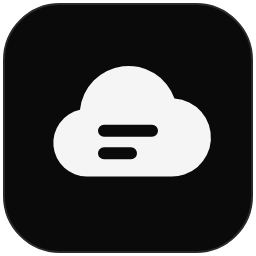
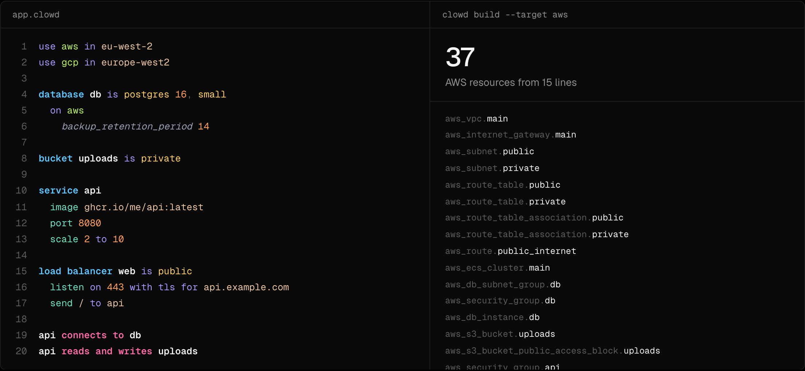

<!-- LOGO -->
<h1>
<p align="center">
  
  <br>Clowd
</h1>
  <p align="center">
    Infrastructure in plain English.
    <br />
    Describe your cloud once, check it against every cloud, and deploy it with OpenTofu.
    <br />
    <a href="#about">About</a>
    ·
    <a href="https://clowd.jooo.sh">Website</a>
    ·
    <a href="#features">Features</a>
    ·
    <a href="#install">Install</a>
    ·
    <a href="#developing">Developing</a>
  </p>
</p>

<p align="center">
  
</p>

## About

Clowd is a small, English-like language for cloud infrastructure. You write
what exists and how it connects, and Clowd compiles it to
[OpenTofu](https://opentofu.org) JSON for whichever cloud you deploy to.

```
use aws in eu-west-2
use gcp in europe-west2

database db is postgres 16, small

service api
  image ghcr.io/me/api:latest
  port 8080

api connects to db
```

It started from a few gripes with Terraform: it's verbose, it's
cloud-specific, and you find out what a cloud won't do halfway through an
apply. Clowd aims to fix those:

- **Short.** The 15-line example in [`examples/app.clowd`](examples/app.clowd)
  builds 37 AWS resources: the VPC, subnets, security groups, IAM roles,
  autoscaling and certificate included.
- **Portable.** You write `service` or `database`, not ECS Fargate or Cloud
  SQL. Clowd picks the product on each cloud.
- **Checked.** `clowd check` tells you, per cloud, whether a file will deploy,
  in a few milliseconds and before anything touches your account.

There's no new engine underneath: OpenTofu does the planning, state and
deploying, and you can read the generated configuration or take it and leave.

> **Beta.** The language, `clowd check`, the formatter, the editor support and
> AWS deploys work today. GCP deploys are new: built and validated, with the
> first run against a real project still to come. Expect the language to
> change before 1.0.

## Features

### The language

A file is a list of short sentences, with no braces, colons or quotes. There
are four kinds of statement: `use` a cloud, declare a resource, relate two
resources, and `on <cloud>` for provider settings. Keywords are
case-insensitive, and each idea has exactly one way to say it.

| Kind | AWS | GCP |
| --- | --- | --- |
| `service` | ECS Fargate | Cloud Run |
| `database` | RDS | Cloud SQL |
| `bucket` | S3 | Cloud Storage |
| `load balancer` | Application Load Balancer | Application Load Balancer |
| `queue` | SQS | Pub/Sub |

### Relationships

`api connects to db` is one line that opens the database's security group to
the service, grants it the password the cloud generated, and sets `DB_HOST`,
`DB_PORT`, `DB_NAME`, `DB_USER` and `DB_PASSWORD` in it. The verbs are
`connects to`, `reads`, `writes`, `reads and writes` and `sends to`, and the
variables they set are the same on every cloud.

### Know before you deploy

For a service that scales to zero (`scale 0 to 5`) and a FIFO queue:

```
$ clowd check
app.clowd → aws, gcp

Resources            aws  gcp
  service api        ✗    ✓    aws: ECS Fargate can't start a task for an incoming request, so the minimum must be at least 1
  queue jobs         ✓    ⚠    gcp: Pub/Sub has no FIFO queues; this uses an ordered, exactly-once subscription, which limits throughput

Relationships
  api sends to jobs  ✓    ✓

✓ supported  ⚠ emulated  ✗ unavailable  – not applicable
✓ deployable to gcp · ✗ not deployable to aws
```

Mistakes get rustc-style errors with a fix, and the parser keeps going so one
run shows everything:

```
error: unknown relationship `links to`
 --> app.clowd:4:5
  |
4 | api links to db
  |     ^^^^^^^^
  = help: did you mean `connects to`?
```

### Escape hatches

When the portable words run out, an `on aws` or `on gcp` block passes raw
provider arguments through, and `clowd check` verifies each key exists on the
generated resource.

```
service api
  image ghcr.io/me/api:latest
  on aws
    capacity_provider_strategy
      capacity_provider FARGATE_SPOT
      weight 1
```

### Editor

`clowd lsp` is built into the binary: live diagnostics, hovers that show
what a resource becomes on each cloud, completion, formatting, and
highlighting from the real parse. The [VS Code extension](editors/vscode)
and the [Vim and Neovim plugin](editors/vim) set it up for you, and any
other LSP editor can run it. `clowd fmt` formats files in one canonical
style.

## Install

You need Go 1.26+.

```sh
go install github.com/joshjkns/clowd/cmd/clowd@latest
```

Deploying also needs [OpenTofu](https://opentofu.org/docs/intro/install/) (or
Terraform; 1.11 or later for GCP) and credentials for your cloud. Checking
and building need neither. On GCP, name the project in the file
(`on gcp` / `project <id>`) or set `GOOGLE_PROJECT`.

```sh
clowd init shop     # a starter app.clowd
cd shop
clowd check         # what each cloud thinks of it
clowd apply         # build, plan, and deploy after you confirm
clowd destroy       # remove it all again
```

The full guide is at [clowd.jooo.sh/docs](https://clowd.jooo.sh/docs/).

## Developing

You need Go 1.26+. The website also needs Node 20+.

```sh
go build ./...
go test ./...                     # -update regenerates golden files
go run ./cmd/clowd check examples/app.clowd
cd site && npm install && npm run dev
```

**Stack:** Go (standard library only) · OpenTofu JSON · Next.js and Tailwind
for the website

```
cmd/clowd/          CLI
internal/syntax/    lexer and error-tolerant parser
internal/check/     semantic checks; builds the cloud-neutral IR
internal/capability/ per-cloud capability matrix
internal/lower/     IR → provider resources, one package per cloud
internal/emit/      .tf.json output
internal/format/    clowd fmt
internal/lsp/       language server
editors/            VS Code extension, Vim and Neovim plugin
site/               clowd.jooo.sh
docs/plans/         design docs; decisions.md logs why
```

The design starts at [`docs/plans/00-overview.md`](docs/plans/00-overview.md),
and [`CLAUDE.md`](CLAUDE.md) has the conventions for contributing.

---

<p align="center"><sub>Not affiliated with AWS, Google Cloud or OpenTofu.</sub></p>
